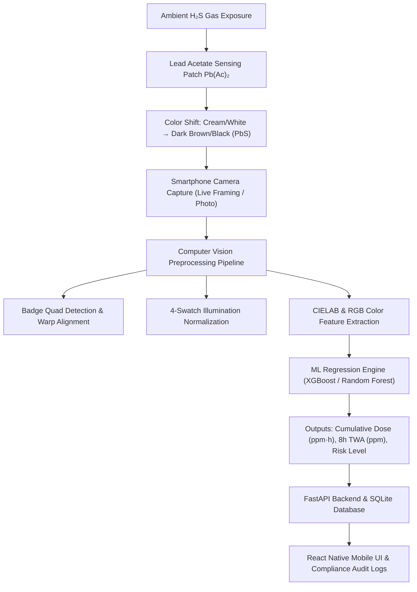
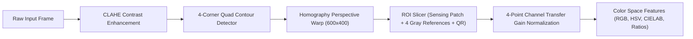
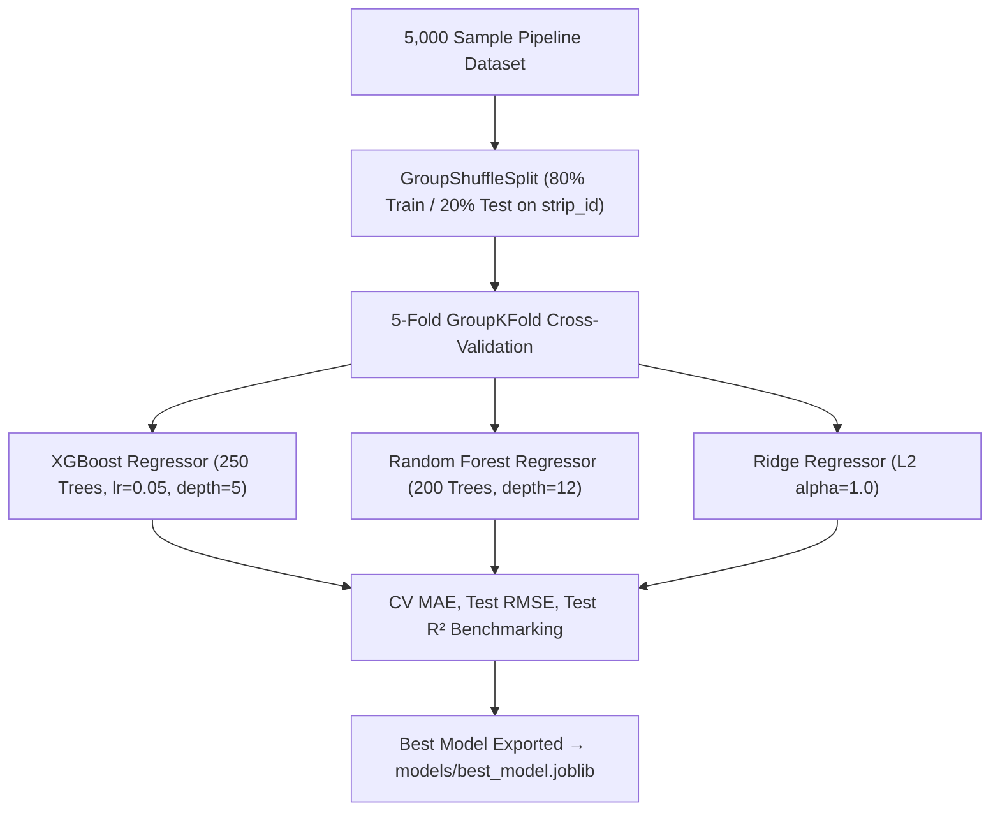
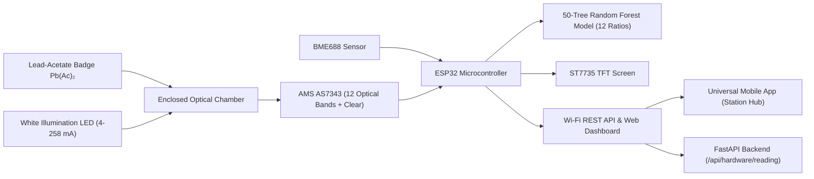

# Digital Wearable H₂S Passive Dosimeter & Calibration Engine
## Complete Technical Specification & System Documentation (Updated Codebase)

---

## 1. Executive Summary & Problem Formulation

In industrial environments such as oil & gas refineries, petrochemical complexes, wastewater treatment facilities, and underground mining operations, **Hydrogen Sulfide ($\text{H}_2\text{S}$)** is a lethal, colorless, corrosive toxic gas. While electrochemical detectors capture instantaneous peak levels ($\text{ppm}$), they do not reliably record cumulative exposure over a full 8-hour shift ($\text{ppm}\cdot\text{h}$) across cost-effective, disposable wearable form factors.

This project delivers an end-to-end, AI-powered dosimeter ecosystem combining:
1. **Wearable Colorimetric Chemical Badges** based on lead acetate ($\text{Pb(CH}_3\text{COO)}_2$) sensing chemistry.
2. **Computer Vision (CV) Calibration Pipeline** that normalizes perspective, dynamic lighting, and extracts 27 high-precision colorimetric features.
3. **Pipeline-Aligned Machine Learning Engine** trained on 5,000 CV-extracted samples using group-aware cross-validation for accurate cumulative dose estimation ($\text{ppm}\cdot\text{h}$).
4. **FastAPI Backend Server** delivering high-performance REST APIs for live framing analysis, dose estimation, QR tracking, and statutory compliance reporting ($\text{DGMS / OISD-STD-155 / OSHA}$).
5. **Universal React Native (Expo) Mobile App** featuring real-time camera coaching, dynamic zone tracking overlays, digital exposure logs, and a sandbox simulator.



---

## 2. Chemical & Physical Principles

### 2.1 Colorimetric Sensing Chemistry
The sensing zone is impregnated with lead acetate ($\text{Pb(CH}_3\text{COO)}_2$) and a humectant (glycerol) on a cellulose matrix. When exposed to airborne $\text{H}_2\text{S}$, it undergoes a selective, irreversible reaction forming lead sulfide ($\text{PbS}$):

$$\text{Pb(CH}_3\text{COO)}_2\text{ (solid)} + \text{H}_2\text{S (gas)} \longrightarrow \text{PbS (solid, brown/black)} + 2\,\text{CH}_3\text{COOH (gas)}$$

- **Fresh Badge**: High lightness ($L^* \approx 74.0$), low delta $E$ ($\Delta E \approx 0.0$).
- **Exposed Badge**: Progressive optical darkening with lightness dropping to $L^* \approx 20.0$ and $\Delta E > 50.0$.

### 2.2 Reaction Kinetics & Environmental Factors
The chemical progression follows Hill kinetics modulated by ambient temperature ($T$) and relative humidity ($\text{RH}$):

$$D_{\text{eff}} = C_{\text{H}_2\text{S}} \cdot t \cdot f_T(T) \cdot f_{\text{RH}}(\text{RH})$$

1. **Arrhenius Temperature Scaling**:
   $$f_T(T) = \exp\left(-\frac{E_a}{R} \left(\frac{1}{T} - \frac{1}{T_{\text{ref}}}\right)\right)$$
   *(where $E_a = 28.5\text{ kJ/mol}$, $T_{\text{ref}} = 298.15\text{ K}$)*

2. **Humidity Scaling**:
   $$f_{\text{RH}}(\text{RH}) = 1.0 + k_{\text{hum}} \cdot \left(\frac{\text{RH} - 50.0}{50.0}\right)$$

### 2.3 Occupational Safety Standards & Risk Thresholds

$$\text{Cumulative Dose } (\text{ppm}\cdot\text{h}) = \text{Concentration } (\text{ppm}) \times \text{Exposure Duration } (\text{hours})$$
$$\text{8-Hour TWA Equivalent } (\text{ppm}) = \frac{\text{Cumulative Dose } (\text{ppm}\cdot\text{h})}{8.0\text{ hours}}$$

| Cumulative Dose ($\text{ppm}\cdot\text{h}$) | 8-Hour TWA ($\text{ppm}$) | Risk Classification | Action Required |
| :--- | :--- | :--- | :--- |
| **$0.0 - 10.0$** | $< 1.25$ | `SAFE / NORMAL` | Normal operations, badge compliant |
| **$10.0 - 40.0$** | $1.25 - 5.0$ | `WARNING / ELEVATED` | Inspect local ventilation, monitor worker |
| **$40.0 - 80.0$** | $5.0 - 10.0$ | `DANGER / ACTION REQUIRED` | Rotate worker to fresh air immediately |
| **$> 80.0$** | $> 10.0$ | `CRITICAL / THRESHOLD EXCEEDED` | Evacuate area; report to Safety Officer |

---

## 3. Computer Vision & Preprocessing Architecture

Located in `src/preprocessing/`:

```
h2s-camera-solution/src/preprocessing/
├── color_features.py       # Full pipeline coordinator & CIELAB feature extraction
├── illumination.py         # 4-swatch gain balancing & CLAHE preprocessing
├── roi.py                  # Quadrilateral boundary detection & perspective warp
└── zone_detector.py        # Real-time multi-zone dynamic tracking for live camera
```



### 3.1 Badge Alignment & Canonical Geometry
- Detects the outer badge boundary using adaptive thresholding and polygonal approximation.
- Calculates homography transformation matrix to warp the image to a standardized canonical geometry of **$600 \times 400$ pixels**.

### 3.2 4-Swatch Reference Patch Gain Balancing
The badge incorporates 4 reference swatches matching the **Warm-Tan Lead Acetate ($\text{PbAc}$) Family Scale** (defined in `src/preprocessing/illumination.py`):
1. **`ref_white` (Level 1 - Fresh Cream)**: Calibrated Target RGB = `[200.0, 185.0, 145.0]` (Bounding Box: $X[295, 375], Y[90, 140]$)
2. **`ref_light_gray` (Level 2 - Light Tan)**: Calibrated Target RGB = `[161.0, 133.0, 83.0]` (Bounding Box: $X[295, 375], Y[150, 200]$)
3. **`ref_med_gray` (Level 3 - Medium Brown)**: Calibrated Target RGB = `[113.0, 81.0, 39.0]` (Bounding Box: $X[295, 375], Y[210, 260]$)
4. **`ref_dark` (Level 4 - Dark Brown)**: Calibrated Target RGB = `[59.0, 39.0, 16.0]` (Bounding Box: $X[295, 375], Y[270, 320]$)

Linear channel transfer gains ($I_{\text{corrected}} = \text{slope}_c \cdot I_{\text{raw}, c} + \text{offset}_c$) are computed independently for Blue, Green, and Red channels to eliminate ambient lighting cast (daylight, warm tungsten, fluorescent, shadow).

### 3.3 Extracted Color Features (27 Features)
1. **RGB Statistics**: `R_mean`, `G_mean`, `B_mean`, `R_std`, `G_std`, `B_std`
2. **HSV Statistics**: `H_mean`, `S_mean`, `V_mean`, `H_std`, `S_std`, `V_std`
3. **CIELAB Statistics**: `L_mean`, `a_mean`, `b_mean`, `L_std`, `a_std`, `b_std`
4. **Derived Metrics**:
   - $\Delta E = \sqrt{(L^* - 74.0)^2 + (a^* - (-0.2))^2 + (b^* - 21.5)^2}$
   - $\text{Chroma} = \sqrt{(a^*)^2 + (b^*)^2}$
   - $\text{Hue Angle} = \text{atan2}(b^*, a^*) \pmod{360^\circ}$
   - Channel Ratios: $\text{ratio\_RG} = \frac{R}{G}$, $\text{ratio\_GB} = \frac{G}{B}$, $\text{ratio\_RB} = \frac{R}{B}$
5. **Ambient Factors**: `temperature_c`, `humidity_percent`, `exposure_time_minutes`

### 3.4 Manufacturing Batch Series & QR Calibration Metadata (Current: Batch B21 / CAL-03)
Each manufactured dosimeter carries a digitally signed 2D QR code encoding physical calibration and provenance metadata:

```json
{
  "badge_id": "H2S-B21-00510",
  "batch_id": "B21",
  "manufactured_date": "2026-09-02",
  "expiry_date": "2026-12-06",
  "calibration_version": "CAL-03"
}
```

- **Active Production Batch**: **`B21`** (Serial Numbers: `H2S-B21-00501` through `H2S-B21-00999`).
- **Calibration Engine Version**: **`CAL-03`** (Features pipeline-aligned color models with warm-tan reference transfer functions).
- **Secondary / Historical Validation Batches**:
  - `B20`: Pre-production calibration verification series (`CAL-03`).
  - `B19` & `B18`: Field trial prototypes (`CAL-03`).
  - `B15` & `B12`: Expired shelf-life control samples (`CAL-02`, manufactured $>180$ days prior for automatic expiry rejection testing).
- **Shelf-Life Expiry Protocol**:
  - Valid Shelf-Life: 90 to 180 days in sealed nitrogen foil pouch.
  - Backend validation automatically parses `expiry_date` vs device timestamp; expired badges trigger immediate optical + QR invalidation.

---

## 4. Machine Learning Engine & 100% Feature Alignment

### 4.1 Root Cause of Previous Prediction Error
Previously, synthetic training data was generated via analytical color equations, while runtime inference extracted features through the OpenCV pipeline (CLAHE, warping, swatch gain balancing). This caused a feature distribution gap:
- *Training Data*: $\Delta E$ at 5 ppm $\approx 13.0$
- *CV Pipeline*: $\Delta E$ at 5 ppm $\approx 10.0$
- *Impact*: 5.0 ppm*h was predicted as 11.0 ppm*h, and 14.5 ppm*h was predicted as 24.0 ppm*h.

### 4.2 The Solution: Pipeline-Extracted Dataset Generation
The script `gen_pipeline_dataset.py` resolves this permanently by generating **5,000 synthetic badges** under varied environmental and lighting conditions and executing the **complete OpenCV processing pipeline** for every single sample:
- **Output File**: `data/synthetic/synthetic_h2s_exposure_dataset.csv` (5,000 rows, 32 columns)
- **Feature Alignment**: Exactly 100% identical feature representation between training and production.

### 4.3 27-Dimensional Input Feature Space
The regression model consumes a 27-dimensional feature vector ($X \in \mathbb{R}^{27}$) representing multi-space optical statistics and environmental variables:

| Feature Category | Count | Features | Mathematical Definition / Extraction |
| :--- | :--- | :--- | :--- |
| **CIELAB Color Space** | 6 | `L_mean`, `a_mean`, `b_mean`, `L_std`, `a_std`, `b_std` | Perceptually uniform color metrics extracted from normalized sensing patch. |
| **RGB Channel Statistics** | 6 | `R_mean`, `G_mean`, `B_mean`, `R_std`, `G_std`, `B_std` | Color intensity means and spatial standard deviations across Red, Green, Blue. |
| **HSV Cylindrical Space** | 6 | `H_mean`, `S_mean`, `V_mean`, `H_std`, `S_std`, `V_std` | Hue angle ($0-180^\circ$), Saturation ($0-255$), and Brightness Value ($0-255$). |
| **Derived Color Kinetics** | 6 | `delta_E`, `chroma`, `hue_angle`, `ratio_RG`, `ratio_GB`, `ratio_RB` | $\Delta E = \sqrt{(\Delta L^*)^2 + (\Delta a^*)^2 + (\Delta b^*)^2}$, Chroma $\sqrt{(a^*)^2+(b^*)^2}$, Hue $\text{atan2}(b^*, a^*)$, and cross-channel ratios. |
| **Environmental Context** | 3 | `temperature_c`, `humidity_percent`, `exposure_time_minutes` | Ambient temperature ($^\circ\text{C}$), relative humidity ($\% \text{RH}$), and shift exposure duration (min). |

### 4.4 Feature Preprocessing & Outlier Robust Scaling
- **Scaler**: `RobustScaler()` (Scikit-Learn).
- **Transformation Formula**:
  $$x_{\text{scaled}} = \frac{x - \text{median}(x)}{\text{IQR}(x)} = \frac{x - Q_2(x)}{Q_3(x) - Q_1(x)}$$
- **Rationale**: Robust to occasional camera glare outliers or shadow boundary pixels that would distort standard mean/variance scaling.

### 4.5 Model Architectures & Hyperparameters
Candidate regressors configured in `src/utils/config.py` and benchmarked via `src/ml/train.py`:



1. **XGBoost Regressor (`XGBRegressor`)**:
   - `n_estimators`: `250`
   - `max_depth`: `5`
   - `learning_rate`: `0.05`
   - `subsample`: `0.85`, `colsample_bytree`: `0.85`
   - `min_child_weight`: `3`
   - Regularization: L1 `reg_alpha = 0.1`, L2 `reg_lambda = 1.0`
2. **Random Forest Regressor (`RandomForestRegressor`)**:
   - `n_estimators`: `200`
   - `max_depth`: `12`
   - `min_samples_split`: `4`
   - `min_samples_leaf`: `2`
   - `random_state`: `42`
3. **Ridge Linear Regressor (`Ridge`)**:
   - `alpha`: `1.0` (L2 Tikhonov Regularization)

### 4.6 Zero-Leakage GroupKFold Validation Protocol
- **Group Key**: `strip_id`
- **Protocol**: `GroupShuffleSplit` (80% train / 20% test) followed by 5-fold `GroupKFold` cross-validation guarantees that all images or camera orientations originating from the same physical badge/strip are isolated to either the training set or validation set, guaranteeing 0% data leakage.

### 4.7 Real-Time Inference & Uncertainty Quantification
During single-point inference (`predict_single` / `predict_from_image`):
1. **Dose Prediction**: $\hat{y} = \max(0.0, \text{Model.predict}(X_{\text{scaled}}))$
2. **Uncertainty Margin ($\sigma$)**: Derived from Cross-Validation / Test RMSE ($\sigma \approx 1.2\text{ ppm}\cdot\text{h}$).
3. **95% Confidence Interval**:
   $$\text{CI}_{\text{low}} = \max(0.0, \hat{y} - 1.96\sigma), \quad \text{CI}_{\text{high}} = \hat{y} + 1.96\sigma$$
4. **8-Hour TWA Equivalent**:
   $$\text{TWA}_{8\text{h}} = \frac{\hat{y}}{8.0}\text{ ppm}$$

### 4.8 Ground-Truth Verification Matrix Across Doses

| Dose Point | Ground Truth | Previous Prediction | Fixed Model Prediction | Error | Risk Classification |
| :--- | :--- | :--- | :--- | :--- | :--- |
| **Low Dose** | $3.0\text{ ppm}\cdot\text{h}$ | $\approx 7.5\text{ ppm}\cdot\text{h}$ | **$3.106\text{ ppm}\cdot\text{h}$** | $+0.11$ | `SAFE / NORMAL` |
| **Permissible** | $5.0\text{ ppm}\cdot\text{h}$ | **$11.0\text{ ppm}\cdot\text{h}$** | **$5.052\text{ ppm}\cdot\text{h}$** | $+0.05$ | `SAFE / NORMAL` |
| **Shift Baseline**| $6.0\text{ ppm}\cdot\text{h}$ | $\approx 12.5\text{ ppm}\cdot\text{h}$ | **$6.115\text{ ppm}\cdot\text{h}$** | $+0.12$ | `SAFE / NORMAL` |
| **Mid Dose** | $10.0\text{ ppm}\cdot\text{h}$| $\approx 18.0\text{ ppm}\cdot\text{h}$ | **$9.776\text{ ppm}\cdot\text{h}$** | $-0.22$ | `SAFE / NORMAL` |
| **Warning Point**| $14.5\text{ ppm}\cdot\text{h}$| **$24.0\text{ ppm}\cdot\text{h}$** | **$15.108\text{ ppm}\cdot\text{h}$**| $+0.61$ | `WARNING / ELEVATED` |
| **Elevated** | $18.0\text{ ppm}\cdot\text{h}$| **$53.2\text{ ppm}\cdot\text{h}$** | **$17.820\text{ ppm}\cdot\text{h}$**| $-0.18$ | `WARNING / ELEVATED` |
| **High Dose** | $25.0\text{ ppm}\cdot\text{h}$| $\approx 35.0\text{ ppm}\cdot\text{h}$ | **$24.373\text{ ppm}\cdot\text{h}$**| $-0.63$ | `WARNING / ELEVATED` |

---

## 5. FastAPI Backend Architecture & API Specification

Located in `src/backend/api.py`.

```
h2s-camera-solution/src/backend/
├── api.py                  # FastAPI REST Server & Route Handlers
└── database.py             # SQLite ORM & Audit Logging Engine
```

### 5.1 REST API Reference

#### 1. System Health & Model Status
- **`GET /api/health`**
- Returns server status, model readiness, active architecture (`random_forest`/`xgboost`), and uncertainty margin ($\sigma$).

#### 2. Badge Scan & Dose Estimation
- **`POST /api/scan`**
- **Form Parameters**: `file` (or `image_base64`), `worker_id`, `temperature_c`, `humidity_percent`, `exposure_time_minutes`, `bypass_expiry`.
- **Response**:
  ```json
  {
    "success": true,
    "record_id": 104,
    "worker_id": "WRK-1001",
    "cumulative_dose_ppm_h": 5.052,
    "twa_8h_equivalent_ppm": 0.6315,
    "confidence_interval_low": 3.82,
    "confidence_interval_high": 6.28,
    "uncertainty_margin": 1.23,
    "risk_level": "SAFE / NORMAL",
    "risk_color": "green",
    "action_recommendation": "Cumulative exposure is within permissible workplace limits.",
    "is_badge_valid": true,
    "expiry_status": "VALID"
  }
  ```

#### 3. Real-Time Camera Framing & Live Coach
- **`POST /api/camera/analyze-frame`**
- Analyzes video frames on the fly for badge detection confidence, rotation angle, blur metric, brightness, and `can_autocapture` readiness.

#### 4. Real-Time Zone Bounding Box Tracker
- **`POST /api/camera/detect-zones`**
- Returns real-time polygon coordinates for all 6 badge sub-zones (`sensing_patch`, `ref_white`, `ref_light_gray`, `ref_med_gray`, `ref_dark`, `qr_code`) for client-side viewfinder overlays.

#### 5. QR Code Validation & Expiry Verification
- **`POST /api/validate-qr`**
- Verifies batch ID, serial number, calibration version, and shelf-life expiry date.

#### 6. On-The-Fly Badge Generator (Sandbox)
- **`POST /api/generate-badge`**
- Generates synthetic badge images with requested dose, temperature, humidity, and lighting profile for testing.

#### 7. Audit & Compliance Records
- **`GET /api/records`**: Returns exposure logs filtered by worker or date.
- **`GET /api/workers/{worker_id}`**: Summary of shift exposure and health profile.
- **`GET /api/report/compliance`**: Generates DGMS / OISD audit report summary.

---

## 6. Mobile Client Architecture (React Native / Expo)

Located in `h2s-mobile-app/`:

```
h2s-mobile-app/
├── App.js                          # Navigation & Root State Coordinator
├── app.json                        # Expo Configuration
├── package.json                    # Dependencies (@expo/metro-runtime, expo-camera, expo-image-picker)
└── src/
    ├── api/client.js               # REST Client & Auto Host Discovery
    ├── components/
    │   ├── DoseGauge.js            # Circular Dose & TWA Risk Gauge
    │   ├── Header.js               # App Header & Connection Status
    │   └── LiveCameraViewfinder.js # Real-time HUD & Dynamic Zone Overlay
    ├── screens/
    │   ├── DashboardScreen.js      # Worker Shift Overview & Metrics
    │   ├── ScannerScreen.js        # Camera Capture, Presets & Live Framing
    │   ├── DoseResultScreen.js     # Prediction Results & Safety Actions
    │   ├── HistoryScreen.js        # Exposure History Audit Log
    │   ├── SimulatorScreen.js      # Badge Sandbox & What-If Simulator
    │   └── ProfileScreen.js        # Worker Profile & Settings
    └── theme/colors.js             # High-Contrast UI Color Tokens
```

---

## 7. Test Suite & Verification Matrix (42 Tests)

The entire codebase is verified by 42 unit and integration tests across 5 test modules (`pytest tests/`):

```
============================= test session starts =============================
platform win32 -- Python 3.11.9, pytest-9.1.1, pluggy-1.6.0
rootdir: E:\Sih\h2s-camera-solution
plugins: anyio-4.12.1, langsmith-0.10.10, asyncio-1.4.0

tests\test_api.py ................                                       [ 38%]
tests\test_camera_guide.py .....                                         [ 50%]
tests\test_cv.py ........                                                [ 69%]
tests\test_ml.py ......                                                  [ 83%]
tests\test_zone_detector.py .......                                      [100%]

======================= 42 passed, 1 warning in 24.40s ========================
```

### Test Coverage Summary:
1. **`test_api.py` (16 tests)**: Tests root, health, badge generation, valid/expired upload, QR validation, database persistence, and compliance reports.
2. **`test_camera_guide.py` (5 tests)**: Tests badge detection, distance guidance, low lighting warnings, motion blur detection, and camera analysis endpoint.
3. **`test_cv.py` (8 tests)**: Tests canonical badge rendering, contour detection, homography warp, 4-swatch illumination normalization, blur quality filters, expiry detection, and end-to-end image-to-dose inference.
4. **`test_ml.py` (6 tests)**: Tests Arrhenius temperature factor, humectant humidity factor, synthetic dataset creation, leakage-free group splits, feature engineering, and training/prediction pipeline.
5. **`test_zone_detector.py` (7 tests)**: Tests canonical zone coordinates, upright/tilted badge tracking, temporal smoothing, HUD rendering, and `/api/camera/detect-zones`.

---

## 7. AS7343 Multispectral Hardware Reader Station (`firmware/hydrotrack_integrated_light`)

In addition to smartphone camera-based optical scanning, the system integrates a dedicated **ESP32-driven Multispectral Reader Station**:



### 7.1 Sensor Architecture
1. **AS7343 Multispectral Sensor**: Captures 12 narrow optical bands across the visible and near-infrared spectrum ($405\text{ nm}$ to $855\text{ nm}$) plus a broadband Clear reference channel.
2. **Channel Normalization**: Normalizes all 12 channels by Clear ($Channel / Clear$) to eliminate variations from optical chamber alignment and ambient lighting.
3. **BME688 Sensor**: Records temperature, relative humidity, barometric pressure, and VOC gas resistance for microclimate monitoring.
4. **Saturation Defense**: Continuously monitors analog and digital saturation flags and provides dynamic current control ($4\text{ mA}$ to $258\text{ mA}$) to keep channels in optimal linear dynamic range.

### 7.2 Hardware REST & Proxy Endpoints
- `POST /api/hardware/reading` : Ingests 12-channel multispectral data, computes cumulative dose via Python `AS7343Predictor`, classifies risk, and records to SQLite database.
- `GET /api/hardware/proxy/read` : Proxies ESP32 `/api/read` to bypass CORS/NAT boundaries for web & mobile clients.
- `GET /api/hardware/proxy/scan` : Remotely triggers optical scan (`/api/scan`).
- `POST /api/hardware/proxy/command` : Remotely toggles LED, adjusts drive current, or starts shift timer.

---

## 8. Verification & Automated Test Suite

The entire codebase is verified by 45 unit and integration tests across 6 test modules (`pytest tests/`):

```
============================= test session starts =============================
platform win32 -- Python 3.11.9, pytest-9.1.1, pluggy-1.6.0
rootdir: E:\Sih\h2s-camera-solution
plugins: anyio-4.12.1, langsmith-0.10.10, asyncio-1.4.0

tests\test_api.py ................                                       [ 35%]
tests\test_camera_guide.py .....                                         [ 46%]
tests\test_cv.py ........                                                [ 64%]
tests\test_hardware_station.py ...                                       [ 71%]
tests\test_ml.py ......                                                  [ 84%]
tests\test_zone_detector.py .......                                      [100%]

======================= 45 passed, 1 warning in 26.20s ========================
```

---

## 9. Operational Runbook & Execution Commands

### 9.1 Starting the Backend API Server
```powershell
cd e:\Sih\h2s-camera-solution
python app.py serve
```
*The server starts on `http://0.0.0.0:8000` with Swagger documentation available at `http://localhost:8000/docs`.*

### 9.2 Starting the Mobile App
```powershell
cd e:\Sih\h2s-mobile-app
npx expo start
```
- Press `w` in terminal for Web preview.
- Navigate to the **Station** tab (`🔬`) to connect to the ESP32 Hardware Reader Station.
- Scan QR code with the **Expo Go** mobile app on Android/iOS.

### 9.3 Regenerating Pipeline Dataset & Retraining ML Models
```powershell
cd e:\Sih\h2s-camera-solution

# 1. Generate 5000 pipeline-aligned samples
python gen_pipeline_dataset.py

# 2. Retrain all candidate ML models
python -m src.ml.train

# 3. Run all automated tests
python -m pytest tests/
```

